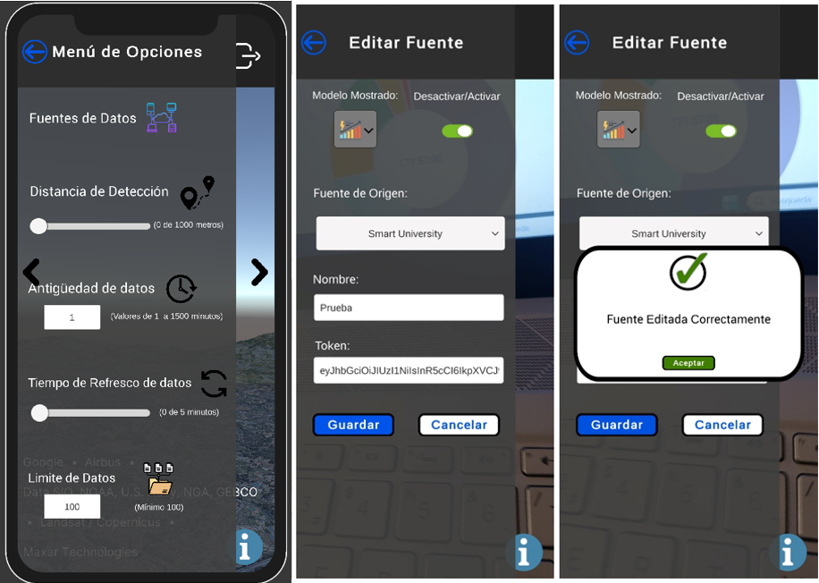
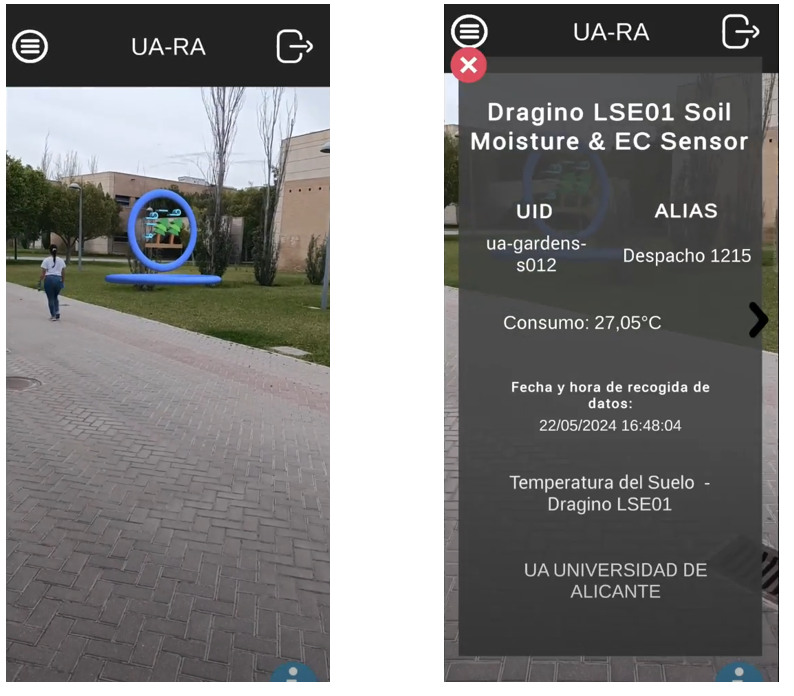

# 🌍 UA-ARData

Aplicación móvil de Realidad Aumentada desarrollada como Trabajo Fin de Grado en Ingeniería Multimedia.

UA-ARData permite visualizar datos geolocalizados del campus de la Universidad de Alicante en tiempo real mediante Realidad Aumentada. Inspirada en la interacción de aplicaciones como Pokémon GO, la aplicación posiciona objetos virtuales sobre ubicaciones reales y permite consultar información contextual de cada punto de interés.

---

## 🚀 Características

- Visualización de fuentes de datos geolocalizadas mediante Realidad Aumentada.
- Integración con la API de Smart University (Universidad de Alicante).
- Geolocalización en tiempo real del dispositivo.
- Representación de datos mediante modelos 3D anclados al mundo real.
- Sistema de detección e interacción mediante Raycast.
- Gestión dinámica de fuentes de datos.
- Persistencia local mediante archivos JSON.
- Configuración de distancia de detección y antigüedad de los datos.

---

## 🏗️ Tecnologías utilizadas

### Desarrollo

- Unity
- C#
- Visual Studio

### Realidad aumentada

- ARCore
- AR Foundation
- Geospatial Anchors

### Datos

- API Smart University (Universidad de Alicante)
- JSON
- Geolocalización GPS

### Diseño

- Blender
- Figma

---

## ⚙️ Funcionamiento

La aplicación obtiene información geolocalizada desde la plataforma Smart University de la Universidad de Alicante.

Cada elemento recibido contiene coordenadas GPS que se utilizan para generar modelos 3D en el entorno real mediante ARCore.

Cuando el usuario se aproxima a una ubicación, puede visualizar el modelo virtual correspondiente y pulsarlo para acceder a información detallada como:

- Consumo eléctrico
- Consumo de agua
- Sensores ambientales
- Puntos de recarga para vehículos eléctricos
- Otros datos proporcionados por Smart University

---

## 🎮 Inspiración

El proyecto toma inspiración de aplicaciones basadas en geolocalización y realidad aumentada como:

- Pokémon GO
- Google Maps AR Navigation
- Ingress

El objetivo era trasladar ese paradigma de interacción al ámbito de la visualización de datos y las Smart Cities.

---

## 🖼️ Galería

### Fuentes de datos

### Visualización mediante Realidad Aumentada e Información del Punto Geolocalizado

---

## 🎓 Contexto académico

Proyecto desarrollado como Trabajo Fin de Grado para la obtención del título de Ingeniería Multimedia en la Universidad de Alicante.

Autor:
Alejandro Gómez Sola

Tutor:
José Vicente Berná Martínez

Año:
2024

---

## 🔮 Trabajo futuro

- Compatibilidad con nuevas plataformas de datos abiertas.
- Mejora de la precisión geoespacial.
- Nuevos modelos 3D e interfaces.
- Integración con fuentes de datos externas a la Universidad de Alicante.
